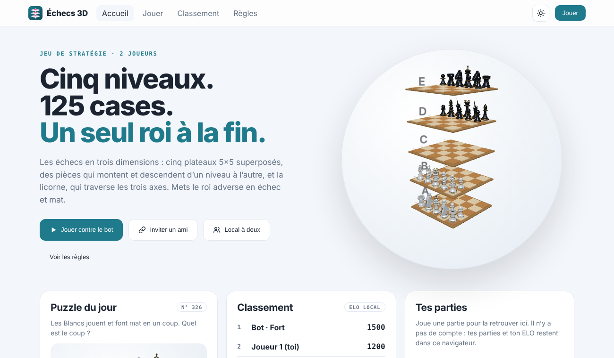

# Échecs à trois dimensions

Jeu d'échecs à trois dimensions sur 5 étages (Raumschach 5×5×5), en three.js. Deux joueurs sur le même écran.



## Lancer

```bash
python3 -m http.server 8000
```

Puis ouvrir http://localhost:8000

## Pièces
Pion, tour, cavalier, fou, licorne (diagonale à travers les 3 axes), dame, roi. Détection de l'échec, de l'échec et mat et du pat.
Pas encore : prise en passant, roque.
